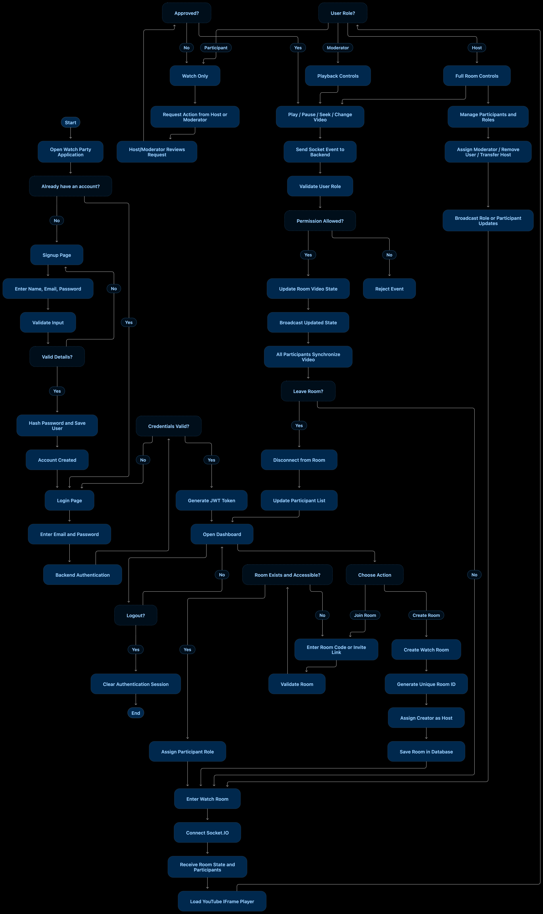

# YouTube Watch Party

Watch YouTube videos together in sync with friends. Built with React, Node.js, Express, Socket.IO, and MongoDB.

## Live Links

- Frontend: https://yt-party-web3task.netlify.app
- Backend: https://yt-party-backend.vercel.app

## Features

- Real-Time Sync: Play, pause, seek, and change videos in sync across all participants.
- Room Management: Create rooms, copy room codes, or share one-click invite links.
- Roles and Permissions:
  - Host: Controls playback, promotes moderators, and manages participants.
  - Moderator: Controls playback and approves participant requests.
  - Participant: Watches in sync and can request playback changes.
- Control Request Workflow: When participants want to play, pause, seek, or change video, hosts and mods can approve or reject the request in real time.
- Tamper-Proof Playback: Transparent click blocker prevents viewers from accidentally pausing or seeking locally.
- Authentication: User signup and login with JWT sessions and MongoDB storage.

## System Architecture


The application uses an authoritative server model:
- Frontend (React 19, Tailwind CSS v4, Vite): Embeds the YouTube IFrame player, connects to WebSockets, and renders the UI.
- Backend (Node.js, Express 5, Socket.IO): Acts as the single source of truth for playback state and validates all commands server-side.
- In-Memory State: Room state (timestamps, play/pause state, active video) is held in memory for sub-millisecond sync.
- MongoDB: Stores user accounts and persists room metadata.

## Workflow



1. Sign In: Users log in or sign up. A JWT is issued and passed to the WebSocket handshake.
2. Create or Join Room:
   - Host creates a room and gets a 6-character code (or copies an invite link).
   - Friends join using the code or direct invite link.
3. Synchronized Watching:
   - When the host plays, pauses, seeks, or changes the video, the server broadcasts `sync_state` to everyone in the room.
   - The YouTube player adjusts automatically. If someone drifts by more than 2 seconds, it snaps them back in sync.
4. Participant Control Requests:
   - Participants cannot change playback directly. Instead, they hit "Request".
   - The host or moderator sees the request and can approve or reject it with one click.

## Tech Stack

- Frontend: React 19, Vite, Tailwind CSS v4, Socket.IO Client
- Backend: Node.js, Express 5, Socket.IO, Mongoose, bcryptjs, jsonwebtoken
- Database: MongoDB Atlas
- Hosting: Netlify (Frontend), Vercel (Backend)

## Project Structure

```text
YOUTUBE-STREAM/
├── backend/
│   ├── api/
│   │   └── index.js              # Vercel serverless entrypoint
│   ├── src/
│   │   ├── config/
│   │   │   └── db.js             # MongoDB connection
│   │   ├── controllers/
│   │   │   └── authController.js # Auth handlers (signup, login, me, logout)
│   │   ├── middleware/
│   │   │   └── auth.js           # JWT middleware (HTTP + Socket.IO handshake)
│   │   ├── models/
│   │   │   ├── Room.js           # Room schema and persistence
│   │   │   └── User.js           # User schema
│   │   ├── routes/
│   │   │   ├── authRoutes.js     # /api/auth routes
│   │   │   └── roomRoutes.js     # /api/rooms routes
│   │   ├── socket/
│   │   │   ├── roomHandler.js    # Socket.IO event listeners
│   │   │   └── roomManager.js    # Room state, RBAC, and approval queues
│   │   ├── utils/
│   │   │   └── crypto.js         # bcrypt hashing and JWT signing
│   │   └── app.js                # Express app, CORS, and cookie parser
│   ├── index.js                  # HTTP and Socket.IO server entrypoint
│   ├── package.json
│   └── vercel.json               # Vercel rewrites configuration
├── frontend/
│   ├── public/
│   │   └── _redirects            # Netlify SPA redirect rules
│   ├── src/
│   │   ├── components/
│   │   │   ├── auth/
│   │   │   │   ├── LoginForm.jsx
│   │   │   │   └── SignupForm.jsx
│   │   │   ├── room/
│   │   │   │   ├── ControlRequestForm.jsx
│   │   │   │   ├── ParticipantList.jsx
│   │   │   │   ├── PendingRequests.jsx
│   │   │   │   ├── PlaybackControls.jsx
│   │   │   │   └── RoomHeader.jsx
│   │   │   └── YouTubePlayer.jsx # YouTube IFrame player with click blocker
│   │   ├── hooks/
│   │   │   ├── useAuth.jsx       # Auth context and session hook
│   │   │   └── useRoomSocket.js  # WebSocket room lifecycle hook
│   │   ├── pages/
│   │   │   ├── HomePage.jsx      # Create and join room
│   │   │   ├── LoginPage.jsx
│   │   │   ├── RoomPage.jsx      # Watch party stage
│   │   │   └── SignupPage.jsx
│   │   ├── services/
│   │   │   └── authService.js    # API client
│   │   ├── utils/
│   │   │   └── youtube.js        # YouTube URL and ID parser
│   │   ├── App.jsx               # Application shell and routing
│   │   ├── index.css             # Tailwind CSS v4 import
│   │   ├── main.jsx              # React root mount
│   │   └── socket.js             # Socket.IO client instance
│   ├── index.html
│   ├── netlify.toml              # Netlify build configuration
│   ├── package.json
│   └── vite.config.js
├── Work-flow.png
├── system architecture.png
└── README.md
```

## Getting Started

### 1. Backend

```bash
cd backend
npm install
cp .env.example .env
npm run dev
```

Runs on `http://localhost:5001`.

### 2. Frontend

```bash
cd frontend
npm install
cp .env.example .env
npm run dev
```

Runs on `http://localhost:5173`.
